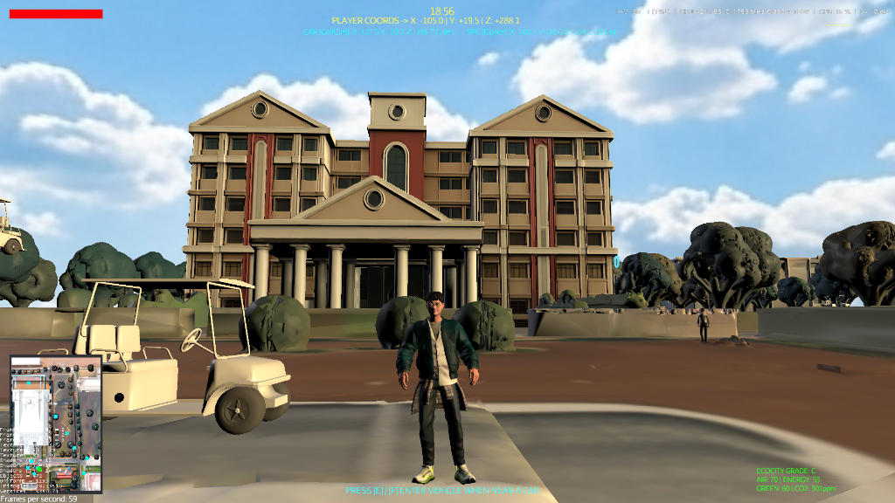
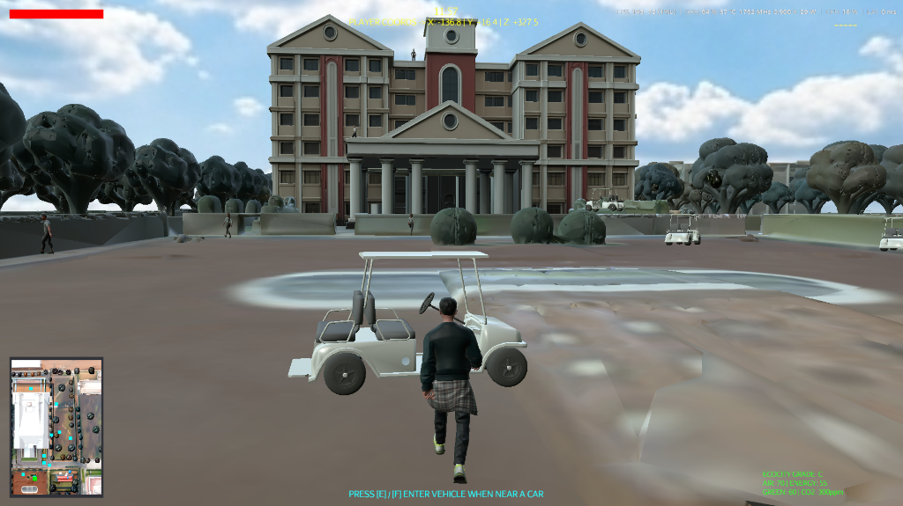
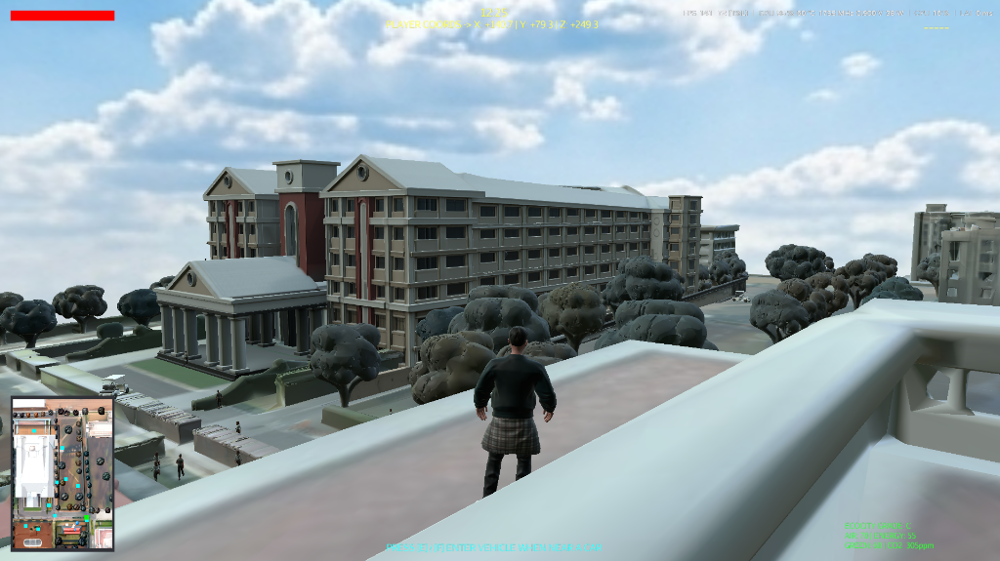
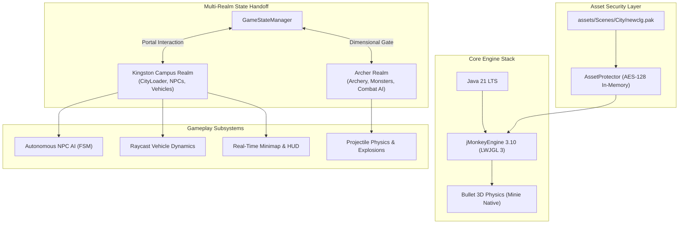

<div align="center">

# 🏛️ Kingston Campus 3D — Open World Game

### A Real-Time 3D Open World Campus Simulation & Action-Adventure Game Built in Java

[](https://github.com/kamalesh404/Kingston-Campus-3D-Game/actions/workflows/build-and-publish.yml)
[](https://github.com/kamalesh404/Kingston-Campus-3D-Game/releases/latest)
[](https://adoptium.net/)
[](https://jmonkeyengine.org/)
[-E0234E.svg)](https://github.com/stephengold/Minie)
[]()
[](LICENSE)

<br/>

### [🎮 Download Playable Game (Windows / Linux / macOS)](https://github.com/kamalesh404/Kingston-Campus-3D-Game/releases/latest)

<br/>



</div>

---

## 📖 Overview

**Kingston Campus 3D** is an open-world 3D simulation and action-adventure game developed entirely in **Java 21** using **jMonkeyEngine 3.10** and the **Bullet Physics Engine (Minie)**. 

The game faithfully reconstructs the campus of **Kingston Engineering College**, offering a living, interactive environment where players can explore the architectural grounds on foot, drive an electric golf cart with raycast suspension physics, interact with autonomous AI students and faculty, and step through a dimensional portal into the **Archer Realm** for third-person archery combat against monsters.

---

## ✨ Key Features

| Feature | Description |
| :--- | :--- |
| 🏫 **Real Campus Recreation** | Architectural 3D scale model of Kingston Engineering College with PBR materials and directional sun shadows. |
| 🚗 **Raycast Vehicle Dynamics** | Driveable electric golf cart featuring independent 4-wheel suspension, acceleration curves, drifting, and collision response. |
| 🧍 **32 Autonomous AI NPCs** | Pedestrians roaming campus pathways driven by multi-state finite state machines (Idle, Walk, Jog, Run, Flee, Converse). |
| 🗺️ **Real-Time Radar Mini-Map** | 2D HUD radar tracking player position, cardinal orientation, vehicle coordinates, and nearby NPCs. |
| 🏹 **Archer Realm Portal** | Seamless multi-realm state handoff transporting the player into an arena with bow & arrow combat, explosive arrows, and monster AI. |
| 🔒 **AES-128 Asset Encryption** | Proprietary binary asset protection (`.pak`) with in-memory decryption ensuring 3D campus models remain secure. |
| 🎯 **Locked 60 FPS & Camera Smoothing** | Fixed-timestep physics simulation (`1/60s`) and interpolated orbital third-person camera eliminating jitter. |
| 💾 **Save & Load System** | Persistent game state saving player coordinates, vehicle state, and progression. |

---

## 📸 In-Game Screenshots

<div align="center">

### 🏫 Main Campus Grounds & Entrance
*Third-person character exploration, real-time minimap radar, HUD coordinates, and dynamic skybox.*


<br/><br/>

### 🚗 Driveable Golf Cart & Physics
*Raycast suspension physics, vehicle interaction, and campus driving simulation.*


<br/><br/>

### 🏙️ Rooftop Aerial Vantage View
*High-altitude perspective highlighting the 3D campus architecture and tree canopy.*


</div>

---

## ⚡ Quick Start — How to Play

### Option 1: Direct Playable Download (Easiest)

1. Go to [**Releases**](https://github.com/kamalesh404/Kingston-Campus-3D-Game/releases/latest) and download `Kingston-Campus-3D-Playable.zip`.
2. Extract the zip archive to any folder.
3. Ensure **[Java 21 LTS](https://adoptium.net/)** is installed on your machine.
4. Launch the game:
   - **Windows:** Double-click `play-windows.bat`
   - **Linux / macOS:** Open terminal and run `./play-linux-mac.sh`

---

### Option 2: Build & Run from Source

```bash
# 1. Clone repository with Git LFS
git clone https://github.com/kamalesh404/Kingston-Campus-3D-Game.git
cd Kingston-Campus-3D-Game
git lfs pull

# 2. Run with Gradle
# Windows (PowerShell):
.\gradlew.bat run

# Linux / macOS:
./gradlew run
```

---

## ⌨️ Game Controls

### Campus Exploration & Driving

| Key / Input | Action |
| :--- | :--- |
| `W` `A` `S` `D` | Move Character / Steer Vehicle |
| `E` or `F` | Interact / Enter or Exit Golf Cart |
| `SPACE` | Jump (On Foot) / Handbrake (In Vehicle) |
| `Q` | Punch / Melee Attack |
| `Mouse` | Orbit Camera |
| `Mouse Scroll` | Zoom Camera In / Out |
| `ESC` | Pause Menu / Resume |
| `F3` | Toggle Bullet Physics Collision Wireframes |

### Archer Realm Combat

| Key / Input | Action |
| :--- | :--- |
| `Right Click (Hold)` | Aim Bow & Arrow (Over-the-shoulder camera) |
| `Left Click` | Release / Fire Arrow |
| `1` / `2` | Switch between Standard Arrows and Explosive Arrows |
| `ESC` / `Q` | Return to Kingston Campus through portal |

---

## 🏗️ Architecture & Technology Stack



### Technology Highlights
- **Engine:** jMonkeyEngine 3.10 with LWJGL 3 (Desktop OpenGL/Vulkan pipeline).
- **Physics Engine:** Bullet 3D via Minie `10.0.0-test1` — fixed 60Hz physics timestep with 4 substeps.
- **Lighting & Materials:** Physically Based Rendering (PBR) with directional sun shadows, ambient sky hemisphere, and non-IBL metallic tuning.
- **AI Finite State Machine:** Pedestrians dynamically switch between idle look-around, pedestrian pathfinding, jogging, fleeing from vehicles, and proximity conversation.
- **CI/CD Automation:** GitHub Actions workflow automatically builds cross-platform fat JARs, packages release zips, and publishes GitHub Releases.

---

## 📊 System Requirements

| Specification | Minimum | Recommended |
| :--- | :--- | :--- |
| **Operating System** | Windows 10/11, Ubuntu 20.04+, macOS 12+ | Windows 11 (64-bit) |
| **Processor** | Intel Core i3 / AMD Ryzen 3 (2.0 GHz) | Intel Core i5 / AMD Ryzen 5 or better |
| **Memory** | 4 GB RAM | 8 GB RAM |
| **Graphics** | Intel UHD 620 / AMD Radeon Vega | Dedicated GPU (NVIDIA GTX 1050+ / AMD RX 560+) |
| **Java Runtime** | Java 21 LTS (OpenJDK / Temurin) | Java 21 LTS |
| **Disk Space** | 800 MB free space | 1.5 GB free space |

---

## 📜 Asset Attribution & Credits

- **Campus Architecture:** 3D model designed and optimized for Kingston Engineering College.
- **3D Engine:** [jMonkeyEngine](https://jmonkeyengine.org/) (BSD 3-Clause License).
- **Physics Library:** [Minie Physics](https://github.com/stephengold/Minie) by Stephen Gold.
- **Sound Effects:** Ambient audio, vehicle engine, and UI sound effects licensed under Creative Commons.

---

<div align="center">

**Built with pride by the Kingston Engineering College Development Team.**

⭐ If you like this project, please consider giving it a **Star** on GitHub!

</div>
